# WFC — Waughtal Foundation Classes

A C++ reimplementation of the VB6 ecosystem:

* VB
* VBA
* VBRUN
* stdole
* MSComctlLib

The project targets Windows x86, x64, and ARM64 and uses WCRT and WSP as its
runtime and engineering-process foundations.

## Current Progress

Milestones MP-0002 through MP-0008 are closed: the VB/VBA language runtime,
classes, projects and COM Automation, forms and intrinsic controls, ActiveX
hosting and component authoring, the nine `MSComctlLib` common controls, and
packaged programs (`wfc --build`). MP-0008 (running real VB6 projects,
starting with archived games) is closed and released as `0.8.0`; MP-0009 (native
x86, AMD64 and ARM64 code generation) is next. See [the roadmap](planning/roadmap-1.0.md).

The captures below come from the test suite, running real VB6 form projects in
native Win32 windows.

**Real VB6 games (MP-0008).** Capture King, a network chess game by Christopher
McKirgan (GPL), run from the
[`vb6games`](https://github.com/Thewafflication/vb6games) corpus: 150 picture
boxes as the board, menus, buttons with pictures, Winsock and Common Dialog
controls, here after four scripted moves. Two copies of it also play a whole
game against each other over real sockets in the test suite (a virtual LAN of
loopback addresses). Its form is laid out as in the author's user guide.

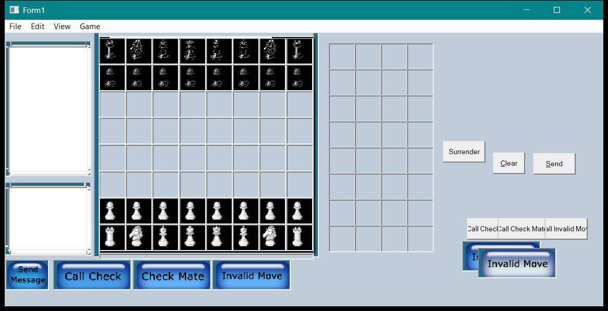

Five more games from the corpus run in WFC without changes to their code. Clix
(a Jawbreaker-style puzzle, MIT) and Executioner (a hangman game from 1999,
GPL-3.0, with sounds and pictures):

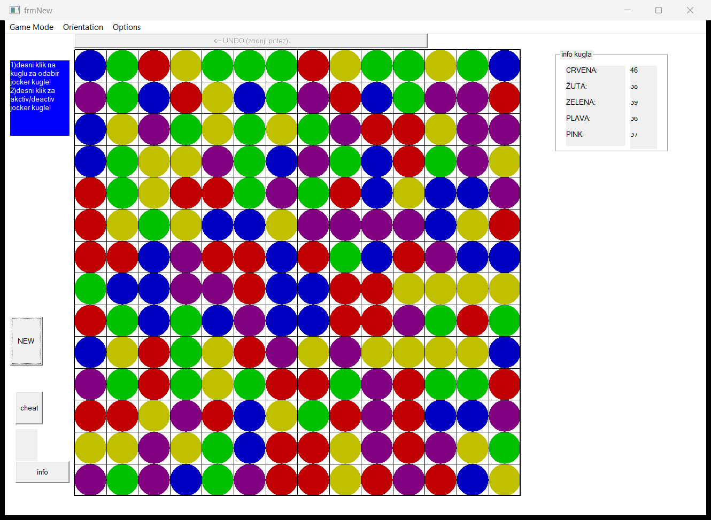


Pipes (GPL-3.0; compared with a build of the same source made with the real
VB6 compiler), Resta Um (peg solitaire, MIT), SuMBOku (a sudoku game, GPL-3.0)
and Connect 4 (GPL-3.0). Connect 4 and the current SuMBOku name the dialog
classes of the author's `Win_Dialogs` library; WFC supplies `ColorDialog`,
`FontDialog`, `OpenFileDialog` and `SaveFileDialog` over its native dialogs:

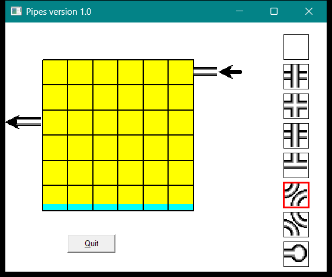

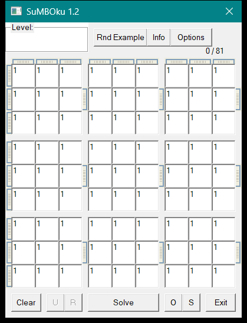
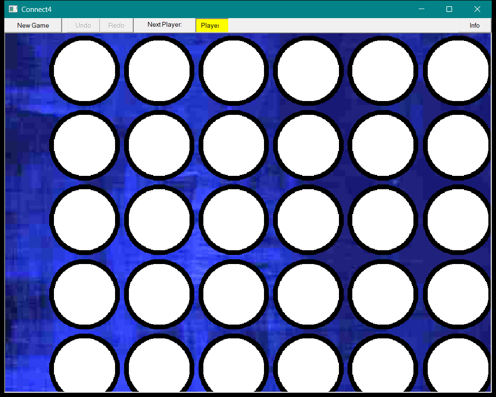

**Watch them play.** These recordings are made from the scripted play sessions
of the test suite (`scripts/New-PlayGif.ps1` runs a session in a native window,
takes a frame after each move and joins them with ffmpeg). Connect 4: yellow
stacks a column, red answers, and Undo and Redo take a chip back and return it.
Resta Um: the standard 31-move solution, ending with one peg. SuMBOku: the
Open dialog (answered by the script) and eight presses of Solve. Capture King:
a whole local game of random moves and chat to a check mate. Pipes: the pipe is laid from the inlet to the
outlet and the water runs. Executioner: letters guessed until the phrase is
found. Clix: groups of balls marked and removed. The interactive showcase: a
text box, buttons, a list, a combo box and a scroll bar driven by the script.

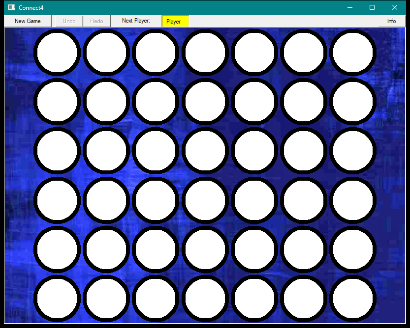
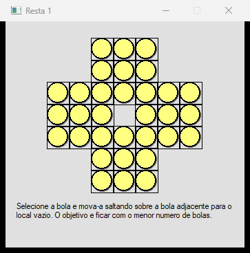
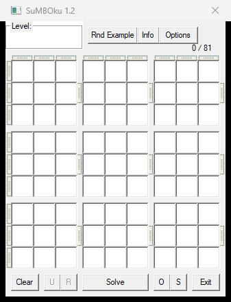
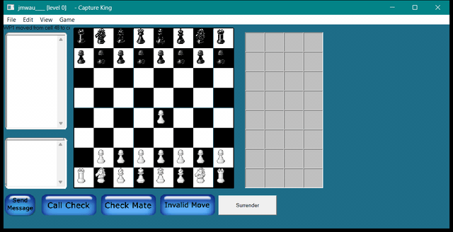


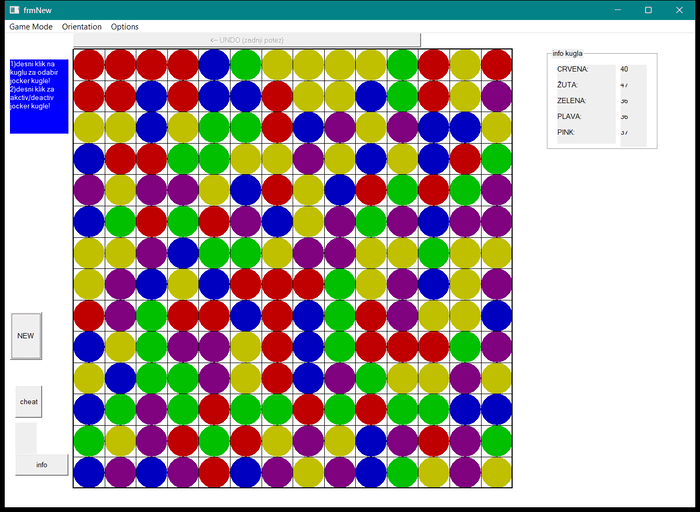


**Common controls (MP-0006).** Toolbar, tab strip, progress bar, slider,
image combo, tree view, list view and status bar, with images from an
`ImageList` (`tests/gui/gui-comctl.vbp`):

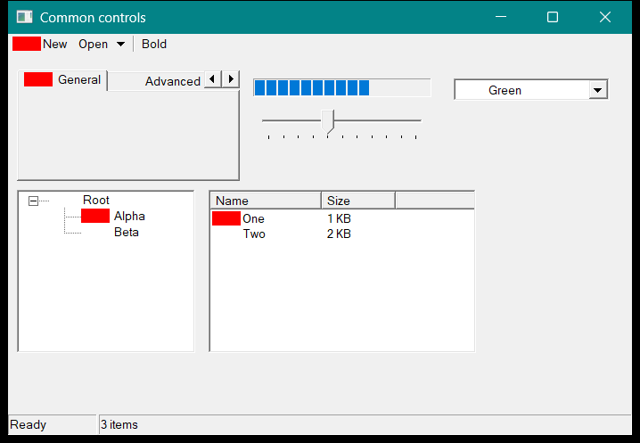

**Intrinsic controls (MP-0004).** Frames, option and check boxes, text box,
list and combo boxes, scroll bar, a timer-driven label, a menu bar, and a
picture box drawn with `Line`, `Circle` and `Print`
(`tests/gui/gui-showcase.vbp`):

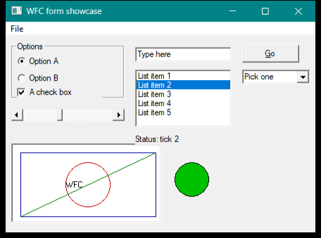

**MDI forms (MP-0004).** A parent form with a child window:

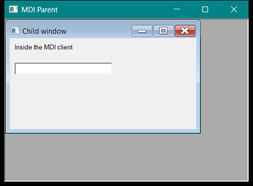

## Planning

The [1.0 compatibility profile](planning/compatibility-profile-1.0.md) defines
the mostly complete replacement claim and its explicit exclusions. The
[roadmap to 1.0.0](planning/roadmap-1.0.md) divides delivery into evidence-gated
milestones from `0.1.0` through release.

The initial work plan was [MP-0001 — Foundation and
Feasibility](planning/MP-0001-foundation-and-feasibility.md), now complete.
The active milestone is MP-0002 — Core VB/VBA Language Execution, tracked in
[`planning/work-log-mp-0002.md`](planning/work-log-mp-0002.md) with delivered
scope indexed in [`requirements/language/README.md`](requirements/language/README.md);
see [`planning/README.md`](planning/README.md) for the full planning index.
The [VB6 discovery baseline](planning/reference-environment.md) records the
installed reference components and inspection tools.

The [project requirements index](requirements/README.md) contains the proposed
compatibility contracts produced by discovery.

The [architecture overview](architecture/README.md) defines the component and
dependency boundaries for the implementation.

The [Visual Basic class requirements](requirements/vb/README.md) identify the
form hosts, intrinsic controls, run-time service classes, and behavioral
contracts exposed by VB6.

The [VBA requirements](requirements/vba/README.md) inventory the standard
library classes, function modules, enumerations, and constants.

The [standard OLE requirements](requirements/stdole/README.md) capture the
font, picture, persistence-function, and constant contracts used by VB6 forms.

The [VB6 runtime requirements](requirements/vbrun/README.md) capture the native
runtime binary, export layout, compiler helpers, and language services.

## Install and Use

`wpm install wfc` runs the install script (`scripts/Install-Wfc.ps1`, also in
the package as `Install-Wfc.ps1`). Run as an administrator it installs for every
user into `C:\wfc`; run without administrator rights it installs for the current
user into `C:\wfc\users\<name>`. Either way it:

- puts `bin` on the PATH and sets `WFC_HOME`;
- keeps each library in its own versioned folder,
  `lib\<name>\<version>\<arch>` (`wfcrt`, `wfcvbrun`, and `wfcmscomctl`,
  `wfccomdlg32`, `wfcmswinsck` when built shared), so versions sit side by side;
- adds a Start menu entry and a Windows Terminal profile, "WFC Command Prompt":
  a console with `wfc` on the PATH (`bin\wfc-prompt.cmd`);
- adds an Apps & features entry; `Install-Wfc.ps1 -Uninstall` (or `wpm remove
  wfc`) takes it all away.
- registers the libraries with Windows (`regsvr32`): `HKLM` for a machine
  install, `HKCU` for a user install. The registration records the version and
  the path under `Software\WFC\Libraries\<name>` and gives every control a
  ProgID and class id of WFC's own (`WFC.MSComctlLib.ListView`). Add
  `-RegisterMicrosoftIds` to serve the Microsoft ProgIDs and class ids
  (`MSComctlLib.ListView.2`) as well; the entries that were there are kept and
  come back with the uninstall. `-NoRegister` skips all of it.

The libraries are versioned for the Microsoft component they replace and stay
`0.x` until they match it: `wfcvbrun` 0.6.0 (`MSVBVM60.DLL` 6.0), and
`wfcmscomctl`, `wfccomdlg32`, `wfcmswinsck` 0.6.1 (the 6.1 OCXs of Visual Basic
6.0 SP6). Each library is also a WPM package of its own (`wfc-vbrun`,
`wfc-mscomctl`, `wfc-comdlg32`, `wfc-mswinsck`); installing one copies the DLL
to `lib\<name>\<version>\<arch>` of the installation and registers it, so a
dynamically linked program gets the update without a new wfc
(`scripts/Install-WfcLibrary.ps1`).

The command line:

```text
wfc <project.vbp>                  run a project (compiled to machine code)
wfc check <project.vbp>            compile only, report the first error
wfc build <project.vbp> -o app.exe [--gui] [--link static|dynamic] [--bundle]
wfc libs                           the libraries and their versions
wfc env                            where wfc is installed and what it finds
wfc completion powershell          tab completion (| Out-String | Invoke-Expression)
wfc help [command]
```

A mistake in an option names it and suggests the nearest one (`unknown option
'--natve' (did you mean '--native'?)`); a missing file says so; the exit codes
are 0 done, 1 the program failed, 2 usage error, 3 compile error.

**Static or dynamic libraries.** `wfc build` links the runtime statically by
default: the program is one file holding the whole runtime. `--link dynamic`
writes a small launcher (`wfcl.exe`) that loads `wfcrt.dll` when it starts,
from beside the program (`--bundle` copies it there), from `%WFC_HOME%`, or
from the installation; it refuses a runtime of another major.minor version
and says which file it found. The same holds for the libraries: the three
control libraries (`wfc-mscomctl`, `wfc-comdlg32`, `wfc-mswinsck`) are linked
statically unless CMake is configured with `-DWFC_OCX_SHARED=ON`, which builds
`wfcmscomctl.dll`, `wfccomdlg32.dll` and `wfcmswinsck.dll`; `wfc-vbrun` is built both as
`wfcvbrun.dll` and as the static library `wfcvbrun_static.lib`. The game
packages carry every game both ways (`<game>-x64.exe`, `<game>-x64-dynamic.exe`).

The libraries live in `lib/wfc-vbrun` (the `MSVBVM60` replacement),
`lib/wfc-mscomctl` (`mscomctl.ocx`: TabStrip, Toolbar, StatusBar, ProgressBar,
TreeView, ListView, ImageList, Slider, ImageCombo), `lib/wfc-comdlg32`
(`comdlg32.ocx`: CommonDialog) and `lib/wfc-mswinsck` (`mswinsck.ocx`:
Winsock), each with its own sources, `VERSION` and version resource, ready to
become submodules (`scripts/Convert-LibrariesToSubmodules.ps1`).

## Build the Current Development Slice

Prerequisites are Visual Studio 2022 (Visual Studio 2026 for the ARM64
preset, whose generator is `Visual Studio 18 2026`) with the Desktop
development with C++ workload and CMake 3.28 or newer (4.2 or newer for the
ARM64 preset). Initialize the controlled dependencies after
cloning:

```powershell
git submodule update --init --recursive
```

Configure, build, and test the native x64 debug slice:

```powershell
cmake --preset windows-x64-debug
cmake --build --preset windows-x64-debug
ctest --preset windows-x64-debug
```

Before committing, install the commit gate, which runs lint, build, and the
full tests on every commit (see [commit checks](planning/commit-checks.md)
for tool versions and the canonical `scripts/Invoke-*.ps1` commands):

```powershell
python -m pip install --user --requirement requirements-dev.txt
Install-Module PSScriptAnalyzer -RequiredVersion 1.25.0 -Scope CurrentUser
pre-commit install
```

Equivalent `windows-x86-debug` and `windows-arm64-debug` presets are provided.
ARM64 execution evidence must be collected on a native or approved emulated
ARM64 runner; a successful cross-build alone is not an execution result.

## Run and Test a Form Project

A project with forms lists them in its `.vbp` (`Form=Form1.frm`) and names the
startup form (`Startup="Form1"`). The sources for the examples below are in
[`tests/corpus`](tests/corpus) (`151-form-basic.*` and the other `15x`/`16x`
form cases) and [`tests/gui`](tests/gui).

**Headless run (the default, used by the automated tests).** Add a
`WfcUiScript=` line to the `.vbp` naming an input script, then run the
project. The script plays the part of the user; when it ends, the remaining
forms are closed.

```powershell
# 151-form-basic.vbp contains: Form=151-form-basic.frm, Startup="Form1",
# WfcUiScript=151-form-basic.ui
out/build/windows-x64-debug/Debug/wfc.exe tests/corpus/151-form-basic.vbp
```

An input script has one command per line (`'` or `#` starts a comment):

| Command | Effect |
| --- | --- |
| `click Form1.Command1`, `click Command1`, `click Option1(1)` | click a control or menu item (a bare name searches the loaded forms) |
| `dblclick <control>`, `focus <control>` | double-click, move the focus |
| `set <textbox> some text` / `type <control> text` | replace a text box's text / type keys with key events |
| `press tab`, `press shift+tab`, `press enter`, `press esc`, `press alt+f` | send a key to the focused control (also `space`, letters, `f1`..`f12`) |
| `select <list> <index>` | choose a list or combo box item |
| `scroll <bar> <value>`, `scrollby <bar> <delta>` | drag or step a scroll bar |
| `wait <ms>` | advance the virtual clock so `Timer` controls fire |
| `close <form>` | close a form as the user would |
| `answer msgbox <result>`, `answer inputbox <text>`, `answer popupmenu <item>` | queue the answer for the next dialog |
| `trace` | print the drawing operations (`line`, `circle`, `text`, `picture`, ...) made since the last `trace` |

`Print` in form code writes to the program output when running headless, so
a test can compare it; `Debug.Print` goes to standard error. A test is a
`.vbp` + `.frm` + `.ui` + `.expected` set in `tests/corpus` (the `.expected`
file holds the standard output); re-run `cmake --preset windows-x64-debug` so
CTest picks the new case up.

**Real windows.** `--gui` runs the same project in real Win32 windows (no input
script is used; you operate the form, and closing the last form ends the
program):

```powershell
out/build/windows-x64-debug/Debug/wfc.exe tests/gui/gui-showcase.vbp --gui
```

**Screenshots as evidence.** `--screenshots <folder>` saves a PNG of each form
when it is shown and just before it is unloaded (`<FormName>-shown.png`,
`<FormName>-closing.png`):

```powershell
out/build/windows-x64-debug/Debug/wfc.exe tests/gui/gui-showcase.vbp --gui `
  --screenshots out/screenshots
```

The `TC-MP0004-gui-showcase` and `TC-MP0004-gui-form-timer` tests do exactly
this (these programs close themselves from a timer), so a normal test run
leaves the images in `out/build/<preset>/screenshots/`, and the GitHub Actions
run uploads them with the other Debug evidence. They need an interactive
desktop; without one `--gui` falls back to the headless host and those two
tests fail rather than pass.

A reference capture of the showcase form is kept in
[`evidence/screenshots`](evidence/screenshots/gui-showcase-closing.png).

**Packaged programs.** `--build` writes a self-contained executable: a copy of
the running `wfc` plus the project's files. It has the architecture of the `wfc`
that built it and needs nothing installed (`--gui` stores that option for forms):

```powershell
out/build/windows-x64-debug/Debug/wfc.exe --build tests/gui/gui-showcase.vbp `
  -o out/showcase.exe --gui
out/showcase.exe
```

The program is still interpreted; machine-code generation is not part of
`0.7.0` (see `architecture/adr-0007-native-packaging-and-vbrun.md`). The build
also produces `wfcvbrun.dll`, the `MSVBVM60` export directory with stub exports.

**Running someone else's project.** `--exit-after <ms>` ends a `--gui` run after
that long (closing the forms), and `--ui-script <file>` supplies scripted
input (clicks, drags, `wait`, `screenshot <form> <name>`) to a headless run or,
with `--gui`, to the real windows, so a project can be tested without editing
its `.vbp`.
The `tests/vb6games` submodule holds archived VB6 games for this:

```powershell
git submodule update --init
out/build/windows-x64-debug/Debug/wfc.exe tests/vb6games/captureking/CaptureKing.vbp `
  --gui --exit-after 6000 --screenshots out/screenshots/captureking
```

Run only the form tests:

```powershell
ctest --preset windows-x64-debug -R "TC-MP0004|form" --output-on-failure
```

`wfc --eval <source>` runs a standalone module; `wfc --class <Name> <source>`
(repeatable) supplies one or more class modules alongside it. `wfc
project.vbp` (or `wfc a.bas b.bas c.cls`) loads real VB6 project files: the
`.vbp`'s `Module=`/`Class=` entries are read, standard modules are
concatenated, class modules are registered by their `VB_Name`, and `Sub Main`
is run as the startup routine. The evaluator currently covers, at a high
level: declarations (`Dim`/`Const`/`Static`/`Public`/`Private`, multi-variable
forms, implicit declaration without `Option Explicit`), the value types
`Boolean`, `Byte`, `Integer`, `Long`, `Single`, `Double`, `Currency`,
`Decimal`, `Date`, `String`, `Variant`, `Object`, fixed-length strings,
`Enum` and `Type` (value-semantics user-defined types), control flow (`If`/
`Select Case`/`While`/`Do`/`For`/`For Each`/`With`/`GoTo`/`GoSub`/`On
Error`/`Resume`/`End`), arrays (fixed, dynamic, multi-dimensional, class and
UDT elements), conditional compilation (`#If`), line continuation, the
`Strings`/`Conversion`/`Information`/`Math`/`DateTime`/`Financial`/
`FileSystem`/`Interaction` libraries (including `Split`/`Join`/`Format`,
sequential/binary/random file I/O, `CVErr`), a built-in `Collection`, and
class modules (fields, array fields, methods, properties, `Const`/`Enum`,
`New`/`Me`, `Implements`, events (`Event`/`RaiseEvent`/`WithEvents`), default
members, lazy `As New`, lifecycle hooks, `Public`/`Private`/`Friend`),
the built-in `Scripting.Dictionary`, `FileSystemObject` and `VBScript.RegExp`
classes (usable late- or early-bound), named arguments, `DefType` statements,
numbered lines with `Erl`, single-line procedures, `Static` procedures, `NewEnum`
enumerators, `VBA.`-qualified library calls, and deep recursion (error 28 beyond
5000 nested calls). `Debug.Print` text goes to standard error and a failing
program still shows what it printed before the error, with the failing
`line`/`column` (or `file:line:col` for projects). Programs loaded from files
(`wfc project.vbp`, `wfc a.bas`) print numbers the way VB6 does (a sign position
before and a space after, so `Print 5` writes ` 5 `); `--eval` snippets print
numbers compactly. It does not claim general VB6 compatibility —
see the [language requirements index](requirements/language/README.md) for
exactly what is specified and implemented, `REQ`-numbered and cross-referenced
to its diagnostics and scope boundary, and
[`planning/work-log-mp-0002.md`](planning/work-log-mp-0002.md) for the
chronological build-out and the remaining gaps.

A representative sample (the exhaustive, always-current set of runnable
examples is the `TC-MP0002-*-cli` integration tests in `CMakeLists.txt`):

```powershell
# Basics and control flow
out/build/windows-x64-debug/Debug/wfc.exe --eval 'Print "Hello, WFC!"'
out/build/windows-x64-debug/Debug/wfc.exe --eval "Dim total As Long`nIf True Then`n total = 42`nEnd If`nPrint total"
out/build/windows-x64-debug/Debug/wfc.exe --eval "Dim i As Long`nFor i = 1 To 10`n If i = 3 Then`n  Exit For`n End If`nNext i`nPrint i"
out/build/windows-x64-debug/Debug/wfc.exe --eval "Select Case 7`nCase Is >= 5`n Print `"selected`"`nEnd Select"

# Types, conversions, and strings
out/build/windows-x64-debug/Debug/wfc.exe --eval "Dim x As Currency`nx = 10.5`nPrint x & `" `" & TypeName(x) & `" `" & (10@ / 3@)"
out/build/windows-x64-debug/Debug/wfc.exe --eval "Dim x`nx = 5`nPrint TypeName(x)`nx = Null`nPrint CStr(IsNull(x))"
out/build/windows-x64-debug/Debug/wfc.exe --eval "Print Replace(InStrRev(`"one two one`", `"one`") & `": `" & Mid$(`"Hello, WFC!`", 8, 3), `"WFC`", `"world`")"

# Arrays (fixed-size and dynamic) and the minimal object stub
out/build/windows-x64-debug/Debug/wfc.exe --eval "Dim arr(3) As Long`narr(0) = 10`narr(3) = 40`nPrint arr(0) & `" `" & arr(3) & `" `" & LBound(arr) & `" `" & UBound(arr)"
out/build/windows-x64-debug/Debug/wfc.exe --eval "Dim arr() As Long`nReDim arr(3)`narr(0) = 1`narr(3) = 4`nReDim Preserve arr(5)`nPrint arr(0) & `" `" & arr(3) & `" `" & UBound(arr)"
out/build/windows-x64-debug/Debug/wfc.exe --eval "Dim arr(3) As Long`nDim x As Long`nDim total As Long`narr(0)=10`narr(1)=20`narr(2)=30`narr(3)=40`nFor Each x In arr`ntotal = total + x`nNext x`nErase arr`nPrint total & `" `" & UBound(arr)"
out/build/windows-x64-debug/Debug/wfc.exe --eval "Dim grid(1 To 2, 1 To 3) As Long`ngrid(1, 1) = 1`ngrid(2, 3) = 6`nPrint grid(1, 1) & `" `" & grid(2, 3) & `" `" & LBound(grid, 2) & `" `" & UBound(grid, 2)"
out/build/windows-x64-debug/Debug/wfc.exe --eval "Dim arr(2) As Variant`narr(0) = 5`narr(1) = `"hello`"`narr(2) = True`nPrint TypeName(arr(0)) & `" `" & TypeName(arr(1)) & `" `" & TypeName(arr(2)) & `" `" & TypeName(arr)"
out/build/windows-x64-debug/Debug/wfc.exe --eval "Dim x As Object`nPrint TypeName(Nothing)`nSet x = Nothing`nPrint CStr(x Is Nothing)"

# Class-typed array elements
out/build/windows-x64-debug/Debug/wfc.exe --class Counter "Public value As Long" --eval "Dim arr(1) As Counter`nPrint TypeName(arr) & `" `" & CStr(arr(0) Is Nothing)`nDim c As New Counter`nSet arr(0) = c`nPrint CStr(arr(0) Is c)"

# Procedures, with Optional/ParamArray/array parameters/parenless calls
out/build/windows-x64-debug/Debug/wfc.exe --eval "Function Factorial(n As Long) As Long`nIf n <= 1 Then`nFactorial = 1`nElse`nFactorial = n * Factorial(n - 1)`nEnd If`nEnd Function`nPrint Factorial(5)"
out/build/windows-x64-debug/Debug/wfc.exe --eval "Function Greet(name As String, Optional greeting As String = `"Hello`") As String`nGreet = greeting & `", `" & name`nEnd Function`nFunction Total(ParamArray nums() As Long) As Long`nDim i As Long`nDim s As Long`nFor i = LBound(nums) To UBound(nums)`ns = s + nums(i)`nNext i`nTotal = s`nEnd Function`nPrint Greet(`"World`") & `" | `" & Total(1, 2, 3, 4)"
out/build/windows-x64-debug/Debug/wfc.exe --eval "Sub DoubleAll(nums() As Long)`nDim i As Long`nFor i = LBound(nums) To UBound(nums)`nnums(i) = nums(i) * 2`nNext i`nEnd Sub`nDim arr(2) As Long`narr(0) = 1`narr(1) = 2`narr(2) = 3`nCall DoubleAll(arr)`nPrint arr(0) & `" `" & arr(1) & `" `" & arr(2)"
out/build/windows-x64-debug/Debug/wfc.exe --eval "Function NextId() As Long`nStatic counter As Long`ncounter = counter + 1`nNextId = counter`nEnd Function`nPrint NextId`nCall NextId`nPrint NextId & `" `" & Rnd"
out/build/windows-x64-debug/Debug/wfc.exe --class Counter "Private n As Long`n`nSub Increment()`nn = n + 1`nEnd Sub`n`nProperty Get Total() As Long`nTotal = n`nEnd Property" --eval "Dim c As New Counter`nc.Increment`nCall c.Increment`nPrint c.Total"
out/build/windows-x64-debug/Debug/wfc.exe --eval "Sub Fill(nums() As Variant)`nnums(0) = `"a`"`nnums(1) = 5`nEnd Sub`nDim arr(1) As Variant`nCall Fill(arr)`nPrint TypeName(arr(0)) & `" `" & TypeName(arr(1))"
out/build/windows-x64-debug/Debug/wfc.exe --eval "Function MakeArray() As Long()`nDim result(2) As Long`nresult(0) = 10`nresult(1) = 20`nresult(2) = 30`nMakeArray = result`nEnd Function`nDim x() As Long`nx = MakeArray()`nPrint x(0) & `" `" & x(1) & `" `" & x(2) & `" `" & UBound(x)"

# Class modules: fields, methods, properties, New/Me, lifecycle, Private
out/build/windows-x64-debug/Debug/wfc.exe --class Counter "Public value As Long`n`nSub Increment()`nvalue = value + 1`nEnd Sub`n`nProperty Get Doubled() As Long`nDoubled = value * 2`nEnd Property" --eval "Dim c As New Counter`nCall c.Increment()`nCall c.Increment()`nPrint c.value & `" `" & c.Doubled & `" `" & TypeName(c)"
out/build/windows-x64-debug/Debug/wfc.exe --class Foo "Private n As Long`n`nSub Class_Initialize()`nn = 100`nEnd Sub`n`nSub Class_Terminate()`nPrint `"term `" & n`nEnd Sub`n`nSub Bump()`nn = n + 1`nPrint Me.n`nEnd Sub" --eval "Dim x As New Foo`nCall x.Bump()`nSet x = Nothing"
out/build/windows-x64-debug/Debug/wfc.exe --class Pair "Public a As Long`nPublic b As Long`n`nProperty Get Item(i As Long) As Long`nIf i = 0 Then`nItem = a`nElse`nItem = b`nEnd If`nEnd Property`n`nProperty Let Item(i As Long, v As Long)`nIf i = 0 Then`na = v`nElse`nb = v`nEnd If`nEnd Property" --eval "Dim p As New Pair`np.Item(0) = 10`np.Item(1) = 20`nPrint p.Item(0) & `" `" & p.Item(1)"
```

## License

WFC is free software: you can redistribute it and modify it under the terms of
the GNU General Public License as published by the Free Software Foundation,
either version 3 of the License, or (at your option) any later version
(`GPL-3.0-or-later`). The full text is in [LICENSE](LICENSE). WFC is
distributed in the hope that it will be useful, but without any warranty.

Copyright (C) 2026 Jordan Waughtal.

Third-party material keeps its own license: the `wcrt` submodule is
GPL-3.0-licensed, and the VB6 programs of the `vb6games` corpus are licensed by
their authors (see each project's `PROVENANCE.md`). The reference inventories
under `evidence/` describe Microsoft components and contain no Microsoft code.
